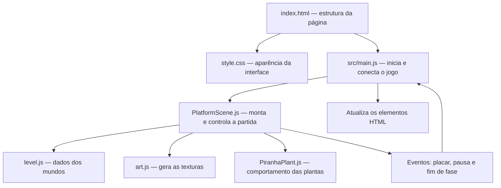

# A estrutura do jogo, passo a passo

[Início da wiki](Home.md) · [Guia de desenvolvimento](Desenvolvimento.md)

Este guia explica a organização do projeto para quem está começando a programar
jogos. O objetivo é entender o papel de cada parte e como elas se conectam, para
aplicar essas ideias aos próximos jogos.

O seu jogo tem **uma página web que apresenta a interface e um jogo Phaser que
roda dentro dela**. A página cuida dos botões, do placar e das mensagens. O Phaser
cuida do personagem, do cenário, dos movimentos e das colisões.

Um detalhe essencial: **existem arquivos do Mario atual e arquivos preservados de
um exemplo antigo de nave**. Por isso, alguns nomes podem enganar: `Player.js`,
por exemplo, não controla o Mario.

## 1. As peças usadas no projeto

| Tecnologia | O que é | Papel neste projeto |
| --- | --- | --- |
| HTML | Linguagem que estrutura a página | Cria títulos, botões, placar e o espaço do jogo |
| CSS | Linguagem de aparência | Define cores, tamanhos, posições e adaptação ao celular |
| JavaScript | Linguagem de programação | Define comportamentos e regras |
| Phaser | Biblioteca para desenvolver jogos em JavaScript | Oferece cenas, imagens, câmera, entrada e integração com a física |
| Arcade Physics | Sistema de física usado pelo Phaser | Calcula velocidade, gravidade e colisões |
| Vite | Ferramenta de desenvolvimento | Serve o projeto durante a programação e prepara a versão para publicação |
| Lucide | Biblioteca de ícones | Fornece desenhos como pausa, som e tela cheia |
| Playwright | Ferramenta de testes | Abre o navegador e verifica comportamentos automaticamente |

Você escreve as regras em JavaScript usando os recursos do Phaser. Por exemplo:
seu código manda o personagem saltar; a física calcula sua subida e sua queda.

## 2. O mapa das pastas

A pasta principal do jogo é `mario-game/`:

```text
super-mario-phaser/
├── .git/
├── package-lock.json
└── mario-game/
    ├── index.html
    ├── style.css
    ├── package.json
    ├── package-lock.json
    ├── vite.config.js
    ├── playwright.config.js
    ├── .nvmrc
    ├── .editorconfig
    ├── .gitignore
    ├── readme.md
    ├── screenshot.png
    ├── src/
    │   ├── main.js
    │   ├── preloader.js
    │   ├── game/
    │   │   ├── art.js
    │   │   └── level.js
    │   ├── gameobjects/
    │   │   ├── PiranhaPlant.js
    │   │   ├── Player.js
    │   │   ├── BlueEnemy.js
    │   │   └── Bullet.js
    │   └── scenes/
    │       ├── PlatformScene.js
    │       ├── MainScene.js
    │       ├── SplashScene.js
    │       ├── MenuScene.js
    │       ├── HudScene.js
    │       └── GameOverScene.js
    ├── public/
    │   └── assets/...
    ├── tests/
    │   └── game.spec.js
    ├── docs/
    │   └── wiki/...
    ├── node_modules/
    ├── dist/
    └── test-results/
```

Os nomes das pastas ajudam a organizar o trabalho:

- `src`: código-fonte, ou seja, o código escrito para construir o jogo.
- `game`: desenhos e dados das fases.
- `gameobjects`: objetos com comportamento próprio.
- `scenes`: cenas que organizam uma parte do jogo.
- `public`: arquivos disponibilizados diretamente ao navegador.
- `tests`: verificações automáticas.
- `docs`: documentação.

**Uma pasta não executa nada sozinha.** O que conecta os arquivos são referências
no HTML, instruções de importação e chamadas de funções.

## 3. O caminho desde abrir a página até começar a jogar

Este é o fluxo principal do Mario:



Se o seu visualizador não renderizar Mermaid, leia assim: o HTML carrega o CSS e
o `main.js`; este inicia a cena, que usa os dados das fases, gera a arte e cria
as plantas. A cena emite eventos, e `main.js` os usa para atualizar a página.

## 4. index.html: a estrutura da página

O [index.html](../../index.html) contém os elementos que compõem a página:

- Cabeçalho e título.
- Indicação do mundo atual.
- Botões de som, reinício, pausa e tela cheia.
- Placar de pontos, moedas, vidas e tempo.
- Janela de pausa e de resultado.
- Botões de toque para celular.
- Textos abaixo do jogo.

Um elemento especialmente importante é:

```html
<div id="phaser-container"></div>
```

Ele reserva o espaço onde o Phaser coloca sua área de desenho, chamada
**canvas**. O personagem e o cenário aparecem nesse canvas.

No final do HTML, esta linha inicia o código:

```html
<script type="module" src="/src/main.js"></script>
```

Isso significa: “carregue `main.js` como um módulo JavaScript”. Um **módulo** é um
arquivo que pode utilizar recursos de outros arquivos e disponibilizar os seus
próprios recursos.

Outro exemplo do HTML:

```html
<span id="coins">00</span>
```

O `id="coins"` é um identificador. O JavaScript usa esse nome para encontrar o
elemento e atualizar o número exibido.

**Influência no jogo:** mudar o HTML altera a estrutura da interface. Para
adicionar um botão que realmente faça algo, também é necessário programar sua
ação.

## 5. style.css: a aparência da interface

O [style.css](../../style.css) define:

- Fontes e cores.
- Espaçamentos e bordas.
- Aparência dos botões e dos diálogos.
- Posição do placar sobre a área do jogo.
- Ajustes para celulares e tela cheia.
- Algumas diferenças visuais entre mundos.

Por exemplo, uma regra para `.hud` afeta o painel do placar. As regras `@media`
ajustam a apresentação conforme características da tela ou do dispositivo.

Há duas escalas diferentes aqui:

- O CSS determina quanto espaço o jogo ocupa na página.
- O Phaser trabalha com uma tela lógica de **960 × 540** e a ajusta para caber
  nesse espaço.

**Influência no jogo:** o CSS muda a apresentação da página. A velocidade do
Mario e a altura do salto são definidas no JavaScript.

## 6. main.js: inicia o Phaser e conecta a interface à partida

O [main.js](../../src/main.js) funciona como a entrada principal do programa.

Logo no início:

```js
import Phaser from "phaser";
import { PlatformScene } from "./scenes/PlatformScene.js";
```

`import` significa “quero usar neste arquivo algo disponibilizado por outro
módulo”. Neste caso, ele importa a biblioteca Phaser e a cena principal.

A criação do jogo começa com:

```js
const game = new Phaser.Game({
```

O objeto entre `{ }` reúne as configurações. Entre elas:

```js
width: 960,
height: 540,
```

Definem o tamanho lógico da área visível.

```js
arcade: { gravity: { y: 1450 }, debug: false },
```

Configura a gravidade vertical.

```js
scene: [PlatformScene],
```

**Registra apenas `PlatformScene` como cena do Mario.** Essa linha explica por
que as outras cenas existentes na pasta não participam da partida atual.

O restante de `main.js` conecta o jogo à página:

| Responsabilidade | Exemplo |
| --- | --- |
| Ouvir mudanças no placar | Recebe o evento `hud` |
| Atualizar a interface | Coloca o número de moedas no HTML |
| Controlar os diálogos | Mostra pausa, derrota ou próximo mundo |
| Responder aos botões | Chama reinício e pausa |
| Tratar controles de toque | Registra esquerda, direita e salto |
| Controlar som | Guarda a preferência de áudio |
| Controlar tela cheia | Solicita esse modo ao navegador |
| Pausar ao sair da página | Evita que a partida continue sem atenção |

Aqui aparecem dois mecanismos importantes.

**Chamada direta:** a interface pede que a cena faça algo.

```js
scene().restartLevel();
```

**Evento:** a cena anuncia que algo aconteceu, e a interface responde. Por
exemplo, `game.events.on("hud", ...)` registra uma ação para o evento `hud`.
`on` significa “quando esse evento acontecer, execute esta ação”.

O `registry` do Phaser também serve como um espaço compartilhado: nele ficam os
controles de toque e a preferência de som.

## 7. level.js: os dados que descrevem as fases

O [level.js](../../src/game/level.js) descreve os três mundos. Ele responde a
perguntas como:

- Onde existe chão?
- Onde ficam os blocos?
- Quantas moedas há e onde estão?
- Onde os inimigos começam?
- Qual é o tempo disponível?
- Como as plantas se comportam?

A lista principal se chama `LEVELS`. Cada item representa um mundo.

Aqui é importante entender as coordenadas:

```text
(0, 0) ─────────────→ x aumenta para a direita
   │
   │
   ↓
   y aumenta para baixo
```

Por isso, uma posição com `y = 200` fica mais alta que outra com `y = 400`.

O arquivo define:

```js
export const WORLD_WIDTH = 4800;
export const FLOOR_Y = 456;
```

`export` disponibiliza esses valores para outros módulos. O mundo tem 4.800
unidades de largura, mas a tela mostra 960 por vez. A câmera acompanha o jogador
para revelar o restante. O chão começa na altura `456`.

Veja alguns dados reais:

```js
[336, 312, "brick"]
```

Dentro da lista de blocos, significa:

- Posição horizontal: `336`.
- Posição vertical: `312`.
- Textura: `"brick"`, o tijolo.

Já `[384, 312, "question"]` configura um bloco surpresa.

Nos trechos de chão:

```js
[0, 1536],
[1680, 2832],
```

Existe chão nesses intervalos. O espaço entre `1536` e `1680` fica sem chão,
formando um buraco.

Para um inimigo:

```js
walker(708, 500, 790, 2, 70)
```

| Valor | Significado |
| --- | --- |
| `708` | Posição inicial |
| `500` | Limite esquerdo da patrulha |
| `790` | Limite direito |
| `2` | Resistência: exige dois saltos sobre ele |
| `70` | Velocidade |

**A conexão essencial:** `level.js` fornece a descrição; `PlatformScene.js` lê
essa descrição e constrói os objetos. Essa separação permite usar a mesma
programação para várias fases.

## 8. art.js: os desenhos do Mario são feitos com código

O [art.js](../../src/game/art.js) gera as texturas usadas pelo jogo de
plataforma. Uma **textura** é uma imagem que pode ser aplicada a um objeto.

Neste projeto, o Mario é descrito por linhas de caracteres:

```js
".....rrrrrr.....",
"....rrrrrrrrr...",
```

Uma paleta associa letras a cores:

```js
r: "#e74736"
```

A função `sprite()` percorre as linhas e desenha pequenos quadrados coloridos.
Pontos ficam transparentes porque não possuem uma cor na paleta.

`createArt()` gera texturas com nomes como:

- `mario-idle`: Mario parado.
- `mario-walk`: pose de caminhada.
- `mario-jump`: pose de salto.
- `goomba`, `goomba-armored`, `goomba-elite`: inimigos.
- `ground`, `dirt`: chão e terra.
- `brick`, `question`, `used`: blocos.
- `coin`, `pipe`: moeda e cano.
- `piranha-open`, `piranha-closed`: planta.
- `fireball`: bola de fogo.
- `stone-ground`, `stone-dirt`: chão e preenchimento de pedra.
- `cloud`, `bush`: decoração.

Quando a cena pede:

```js
.sprite(96, FLOOR_Y - 28, "mario-idle")
```

Ela usa uma textura que `art.js` criou com esse nome.

**Influência no jogo:** mudar a paleta altera as cores; mudar as linhas altera o
desenho. Se mudar as dimensões das imagens, talvez também precise ajustar a área
de colisão.

## 9. PlatformScene.js: o centro das regras do Mario

O [PlatformScene.js](../../src/scenes/PlatformScene.js) reúne a maior parte da
programação da partida.

Uma **cena** organiza objetos e comportamentos de uma parte do jogo. Neste
projeto, a mesma cena é usada para os três mundos, recebendo dados diferentes.

A declaração:

```js
export class PlatformScene extends Phaser.Scene
```

Significa que `PlatformScene` é uma classe baseada na classe de cena do Phaser.
Uma **classe** reúne dados e comportamentos. Uma função dentro de uma classe é
chamada de **método**. O termo `this` se refere à instância atual; por exemplo,
`this.player` é o personagem desta cena.

### O ciclo da cena

| Método | Quando acontece | Responsabilidade |
| --- | --- | --- |
| `constructor()` | Ao criar a instância | Dá à cena seu nome |
| `init(data)` | Ao iniciar ou reiniciar | Escolhe o mundo e recebe pontos, moedas e vidas |
| `create()` | Depois da inicialização | Monta a fase e registra as interações |
| `update(now, delta)` | Repetidamente durante a partida | Atualiza movimento, perigos, tempo e condições de vitória |

Ao trocar de mundo, o jogo reinicia essa cena com o índice do próximo mundo e os
valores que devem continuar.

Dentro de `create()`, o código:

1. Prepara o estado da partida.
2. Gera as texturas.
3. Configura câmera e limites.
4. Constrói chão, blocos e canos.
5. Desenha decoração, castelo e bandeira.
6. Cria o Mario.
7. Cria moedas, inimigos, plantas e projéteis.
8. Registra colisões e controles.
9. Anuncia o início do mundo para a interface.

### Objeto visual e corpo físico

Um objeto pode ter uma imagem e um **corpo físico**, a área usada para calcular
colisões. O Mario usa:

```js
this.player.setSize(18, 30).setOffset(7, 2);
```

Isso ajusta o tamanho e o posicionamento do corpo físico em relação ao desenho.

O cenário também contém imagens puramente decorativas. Uma nuvem pode aparecer
na tela sem ser uma plataforma onde o Mario consegue pisar.

### Colisão e sobreposição

O projeto usa:

```js
this.physics.add.collider(this.player, this.platforms);
```

`collider` faz os corpos interagirem fisicamente: o chão impede o Mario de
continuar caindo.

Também usa `this.physics.add.overlap(...)`. `overlap` detecta quando áreas se
encontram e permite executar uma ação, como coletar uma moeda.

### Movimento e salto

A cada atualização, o código verifica as teclas e os controles de toque.

```js
const speed = SHIFT.isDown ? 315 : 245;
```

Se Shift estiver pressionado, a velocidade é `315`; caso contrário, `245`.

Para saltar:

```js
this.player.setVelocityY(-720);
```

O valor é negativo porque subir significa diminuir `y`. Depois, a gravidade faz o
personagem cair. Soltar o botão durante a subida reduz a velocidade vertical,
produzindo um salto mais curto.

O código também oferece pequenas tolerâncias: aceita um salto apertado pouco
antes de tocar no chão e permite saltar por um breve instante após sair de uma
borda.

### O tempo entre atualizações

`delta` representa o tempo, em milissegundos, desde a atualização anterior.

```js
this.remaining = Math.max(0, this.remaining - delta / 1000);
```

Dividir por `1000` converte milissegundos em segundos. Assim, o cronômetro
acompanha o tempo decorrido.

### Os demais métodos desse arquivo

| Método | Efeito na partida |
| --- | --- |
| `buildBackdrop()` | Desenha montanhas, nuvens, vegetação e detalhes dos mundos |
| `buildCastle()` | Desenha castelo e bandeira |
| `hitBlock()` | Detecta uma batida por baixo em bloco surpresa e libera uma moeda |
| `addCoin()` | Soma uma moeda, acrescenta 100 pontos e toca um som |
| `hitEnemy()` | Decide se o Mario pisou no inimigo ou sofreu dano |
| `isPlayerVulnerable()` | Verifica se o Mario pode receber dano |
| `hitHazard()` | Trata contato com plantas e projéteis |
| `firePlant()` | Cria uma bola de fogo direcionada ao jogador |
| `loseLife()` | Retira uma vida e organiza reaparecimento ou derrota |
| `setPaused()` | Pausa ou retoma física, animações programadas e relógio da cena |
| `restartLevel()` | Reconstrói o mundo atual, recuperando pontos e moedas da entrada e restaurando três vidas |
| `advanceLevel()` | Inicia o próximo mundo preservando pontos, moedas e vidas |
| `restartCampaign()` | Retorna ao primeiro mundo com estado inicial |
| `finish()` | Encerra a fase ou a partida e emite o resultado |
| `tone()` | Produz efeitos sonoros com Web Audio |
| `emitHud()` | Envia os valores do placar à interface quando mudam |

Os efeitos sonoros são produzidos por código; o Mario atual não depende de
arquivos de áudio.

## 10. PiranhaPlant.js: um objeto com comportamento próprio

O [PiranhaPlant.js](../../src/gameobjects/PiranhaPlant.js) concentra o
funcionamento das plantas dos canos.

Cada planta passa por quatro estados:

```text
Escondida → Subindo → Exposta → Descendo → Escondida
```

Os tempos vêm de `level.js`. O método `step(delta, player)` atualiza esse ciclo.
Ele é chamado por `PlatformScene.update()` para cada planta.

O método `applyReveal()` ajusta:

- Quanto da planta aparece.
- O recorte da imagem.
- O tamanho do corpo físico.
- Se a colisão está habilitada.

Isso evita uma planta totalmente escondida com uma área de dano invisível.

A planta também verifica se o Mario está próximo à boca do cano antes de começar
a subir. Quando fica exposta, ela sinaliza à cena; no terceiro mundo, a cena usa
esse sinal para disparar.

Esse arquivo demonstra uma ideia útil para seus próximos jogos: **um
comportamento que tem várias regras próprias pode ficar em uma classe
separada**.

## 11. Exemplo completo: coletar uma moeda

A sequência conecta quase todas as peças principais:

1. `level.js` informa a posição da moeda.
2. `art.js` gera sua textura.
3. `PlatformScene.create()` cria o objeto naquela posição.
4. O sistema de física detecta a sobreposição entre Mario e moeda.
5. A função registrada remove a moeda e chama `addCoin()`.
6. `addCoin()` altera moedas e pontos e produz o som.
7. `emitHud()` emite o evento `hud`.
8. `main.js` recebe o evento.
9. `main.js` atualiza os elementos de `index.html`.
10. `style.css` determina como os números aparecem.

Portanto, coletar uma moeda envolve **dados, desenho, objeto, detecção, regra e
apresentação**.

O botão de pausa percorre o caminho inverso: começa no HTML, passa por `main.js`
e chama uma ação na cena.

## 12. Os arquivos do exemplo antigo de nave

Estes arquivos estão preservados, mas não são importados pelo caminho atual do
Mario:

| Arquivo | Função no exemplo antigo |
| --- | --- |
| `src/preloader.js` | Carregava imagens, animações e fontes antes de abrir a apresentação |
| `src/scenes/SplashScene.js` | Exibia o logo e iniciava `MainScene` |
| `src/scenes/MainScene.js` | Organizava a partida da nave, os tiros, o inimigo e o tempo |
| `src/scenes/MenuScene.js` | Exibia a mensagem para começar e emitia `start-game` |
| `src/scenes/HudScene.js` | Desenhava pontos e tempo dentro do Phaser |
| `src/scenes/GameOverScene.js` | Mostrava o resultado e permitia voltar à partida |
| `src/gameobjects/Player.js` | Controlava a nave, a propulsão e seus tiros |
| `src/gameobjects/BlueEnemy.js` | Controlava o inimigo azul, sua movimentação e sua reação aos ataques |
| `src/gameobjects/Bullet.js` | Controlava os tiros e os efeitos de impacto |

A conexão prevista nesse exemplo era:

```text
Preloader → SplashScene → MainScene
                            ├── MenuScene
                            ├── HudScene
                            ├── Player → Bullet
                            ├── BlueEnemy → Bullet
                            └── GameOverScene
```

**O Mario é criado e controlado diretamente em `PlatformScene.js`.** As bolas de
fogo das plantas também são criadas nessa cena, sem utilizar o `Bullet.js`
antigo.

## 13. public/: imagens e arquivos auxiliares preservados

Os recursos de `public/assets/` pertencem ao exemplo de nave. O Mario atual gera
sua arte em `art.js`.

| Pasta ou arquivos | Finalidade |
| --- | --- |
| `logo.png` | Logo do exemplo |
| `background.png`, `floor.png` | Fundo e chão |
| `flares.png` | Imagem usada em efeitos de partículas |
| `player/player.png` | Imagem da nave |
| `player/bullet.png` | Imagem do tiro |
| `player/propulsion/propulsion-fire.png` | Quadros da propulsão |
| `player/propulsion/propulsion-fire_atlas.json` | Descreve onde os quadros estão na imagem |
| `player/propulsion/propulsion-fire_anim.json` | Descreve a animação |
| `enemies/enemy-bullet.png` | Tiro inimigo |
| `enemies/enemy-rock.png`, `enemies/enemy-yellow.png` | Recursos adicionais de inimigos |
| `enemies/enemy-blue/` | Imagens, atlas e animação do inimigo azul |
| `enemies/enemy-blue-fat/` | Imagens e atlas de outra variante |
| `fonts/pixelfont.png` e `fonts/pixelfont.xml` | Desenhos das letras e descrição de sua localização |
| `fonts/knight3.png` | Outra fonte baseada em imagem |
| `public/favicon.png` | Imagem disponível para ícone da página, fora de `assets/` |

Nos diretórios de inimigos, arquivos como `enemy-blue-0.png`, `enemy-blue-1.png` e
`enemyblue-1.png` são imagens adicionais preservadas.

Um **atlas** permite guardar vários quadros em uma imagem e identificar cada um
por coordenadas. Um arquivo de **animação** descreve como os quadros são
apresentados ao longo do tempo.

O HTML atual usa um ícone vazio por meio de `data:,`; portanto, o `favicon.png`
disponível não está selecionado nele.

## 14. Configuração, documentação e pastas geradas

Esses arquivos ajudam a desenvolver, organizar e distribuir o projeto.

| Arquivo ou pasta | O que faz |
| --- | --- |
| `mario-game/package.json` | Lista bibliotecas e comandos como `dev`, `build` e `test` |
| `mario-game/package-lock.json` | Registra as versões exatas das dependências |
| `vite.config.js` | Configura o Vite; aqui usa caminhos relativos no resultado do build |
| `playwright.config.js` | Configura servidor, endereço, navegador e execução dos testes |
| `.nvmrc` | Indica Node.js 24 para ferramentas de gerenciamento de versão |
| `.editorconfig` | Define convenções de edição, como indentação |
| `.gitignore` | Diz ao Git quais arquivos locais ou gerados devem ser ignorados |
| `readme.md` | Apresenta o projeto e orienta instalação, comandos e documentação |
| `screenshot.png` | Captura estática; não participa da programação da partida |
| `node_modules/` | Contém as bibliotecas instaladas pelo npm |
| `dist/` | Contém a versão preparada para publicação |
| `test-results/` | Guarda resultados e capturas produzidos pelos testes |
| `.git/`, na pasta externa | Guarda o histórico de versões do repositório |
| `package-lock.json`, na pasta externa | Está sem dependências registradas; o projeto executável está em `mario-game/` |

Você normalmente altera os arquivos-fonte e gera `dist/` novamente. Alterar
diretamente os arquivos gerados pode ter seu trabalho sobrescrito no próximo
build.

A documentação em `docs/wiki/` está organizada assim:

| Arquivo | Conteúdo |
| --- | --- |
| [Home.md](Home.md) | Apresentação e índice |
| [Instalacao.md](Instalacao.md) | Como preparar e executar |
| [Como-jogar.md](Como-jogar.md) | Controles e regras |
| [Fases.md](Fases.md) | Características dos mundos |
| [Desenvolvimento.md](Desenvolvimento.md) | Estrutura técnica, personalização e testes |
| [Estrutura-passo-a-passo.md](Estrutura-passo-a-passo.md) | Este guia de aprendizado |

## 15. tests/game.spec.js: como o projeto verifica suas regras

O [game.spec.js](../../tests/game.spec.js) usa Playwright para abrir o jogo no
navegador e verificar situações como:

- Movimento e salto.
- Coleta de moedas e uso único de blocos surpresa.
- Dano, vidas e reaparecimento.
- Pausa e reinício.
- Plantas e bolas de fogo.
- Progressão entre os três mundos.
- Layout e controles no celular.

Em desenvolvimento, `main.js` disponibiliza:

```js
window.__MARIO_GAME__ = game;
```

Os testes usam essa referência para inspecionar e preparar situações da partida.
Ela só é exposta nesse modo.

**Influência no jogo:** os testes verificam o comportamento esperado e ajudam a
perceber quando uma alteração quebra uma regra.

## 16. Como estudar este projeto para criar os próximos jogos

Sugiro ler e experimentar nesta ordem:

| Etapa | Arquivo | Experimento |
| --- | --- | --- |
| 1 | `index.html` | Alterar um texto da página |
| 2 | `style.css` | Alterar a cor de um botão |
| 3 | `level.js` | Mudar o tempo inicial de um mundo |
| 4 | `level.js` | Mover uma moeda e observar as coordenadas |
| 5 | `art.js` | Alterar uma cor do personagem |
| 6 | `PlatformScene.js` | Alterar a velocidade de caminhada |
| 7 | `PlatformScene.js` | Alterar a força do salto |
| 8 | `PiranhaPlant.js` | Acompanhar as transições entre estados |
| 9 | `main.js` | Acompanhar um evento até a atualização do HTML |
| 10 | `tests/game.spec.js` | Ler uma verificação de uma regra que você já entendeu |

Faça uma alteração por vez e observe seu efeito. Para executar, abra o terminal
em `mario-game/` e use:

```bash
npm run dev
```

Esse comando pressupõe que as dependências já foram instaladas. Se for a primeira
execução, siga o [guia de instalação](Instalacao.md).

Um primeiro exercício pode ser trocar, no primeiro mundo de `level.js`:

```js
time: 180,
```

Por:

```js
time: 240,
```

Recarregue a página para começar uma partida nova e confira o cronômetro.

Para um próximo jogo, você pode reaproveitar a divisão de responsabilidades que
já existe aqui: **um arquivo inicia o programa, os dados descrevem as fases, a
arte fornece as imagens, os objetos concentram comportamentos próprios e a cena
coordena a partida**.

Neste projeto, movimento e várias regras ainda estão concentrados em
`PlatformScene.js`; conforme seus jogos crescerem, você poderá separar essas
partes em arquivos próprios, como já foi feito com as plantas.
